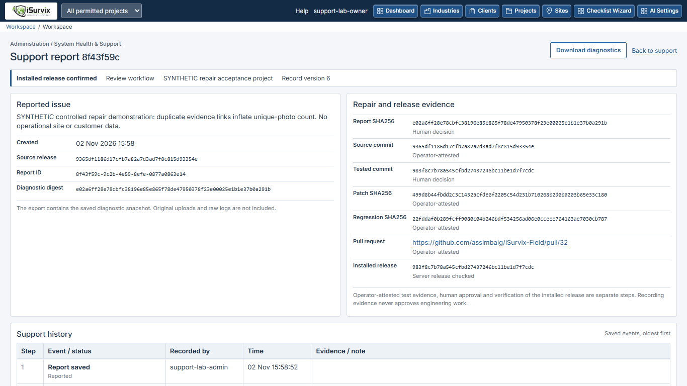

# System Health & Support: team guide

This workspace adds maintenance diagnostics to the existing iSurvix application.
It does not approve survey work, run a model, install a patch or deploy a release.
Use the existing account menu's **System Health & Support** link, or `/support/`.

## Company administrator

1. Read the health summary. Counts cover only currently permitted projects;
   unavailable values are labelled, and AI connectivity is not claimed tested.
2. Select an issue type and, where appropriate, the affected project. Describe
   the steps and expected result without including credentials or private files.
3. Select **Save report**. The saved diagnostic snapshot and its digest remain
   immutable. Refreshing health does not rewrite that saved snapshot.
4. Select **Download diagnostics** to retain an offline ZIP. It contains only
   `manifest.json` and the allowlisted `diagnostics.json`, not the description,
   raw logs, uploaded evidence or secrets. Transfer it only to authorised support.
5. Open the saved report again to follow its compact history. Company admins
   cannot approve a platform repair, release or installation. A report without
   a project is visible only to its creator and the platform owner.

Existing Engineer, QA, Team Lead and Client permissions are unchanged. Those
roles do not gain this administrative support workspace.

## Platform owner and repair operator

The owner requests an isolated repair from the saved report. The separate
operator follows [the repair procedure](SUPPORT_REPAIR_OPERATOR_20261102.md),
using exact source identities, the original exported case/digest and reviewed
regression/fix patches. The web process never executes that code.

Current automated execution supports only the documented synthetic business
adapter. A trusted host controller checks real bounded unit-interface and
file/JSON integration behavior in an offline Docker container. Arbitrary Django
repair execution deliberately fails closed until a protected, reviewed adapter
exists. Candidate console output cannot attest passing tests. No paid API,
cloud repair agent or automatic application-fix generator is connected here.

The publisher creates a real draft PR and verifies that its head equals the
tested commit. A draft may exist while checks run; it must not be recorded as
tested until its exact-head verification succeeds. The operator links its URL
to the receipt. The owner then records that **operator-attested** receipt in
the same saved report. Schema validation is not independent test execution.

**Approve tested repair**, **Approve exact release**, and **Confirm installed
release** are separate audited actions. Installation confirmation is refused
unless the actual configured running release matches the exact approved commit.
These actions record maintenance decisions; they never deploy or approve a
survey. Follow the separate approved update procedure for a real installation.

## Errors and recovery

A failed form shows its error and keeps entered text. If the report changed
elsewhere, review its current history before submitting again. Replayed request
identities do not add duplicate events. A cancelled, incomplete or failed repair
attempt must not supply a successful receipt; retain it and use a fresh isolated
attempt. Unknown source identities cannot bind an isolated repair.

No operational migration has been applied by this development task. The feature
adds migration `0058_support_cases` in the review branch; operational schema0053
must not be silently migrated to test the support interface.

## Checked examples

The controlled lab report `8f43f59c-9c2b-4e59-8efe-0877a0863e14` was created and
exported through the actual browser interface. Its two exact exported JSON
member payloads were used by
[synthetic draft PR32](https://github.com/assimbaig/iSurvix-Field/pull/32).
CI repackages those unchanged members into a ZIP; the ZIP container bytes differ.
The real offline Docker run `41477079364` reproduced the defect and passed the
corrected business probes. The same report retained six events through receipt,
owner approvals and a real BASE-to-FIX lab-server restart. No customer data,
production release or engineering approval was involved. Never merge that
deliberately synthetic rehearsal. The application change is in
[draft PR31](https://github.com/assimbaig/iSurvix-Field/pull/31).

The full release remains gated by pilot, physical/customer/native verification,
licensing, the earlier held security findings and exact owner release approval.
Passing this bounded support demonstration does not satisfy those gates.
